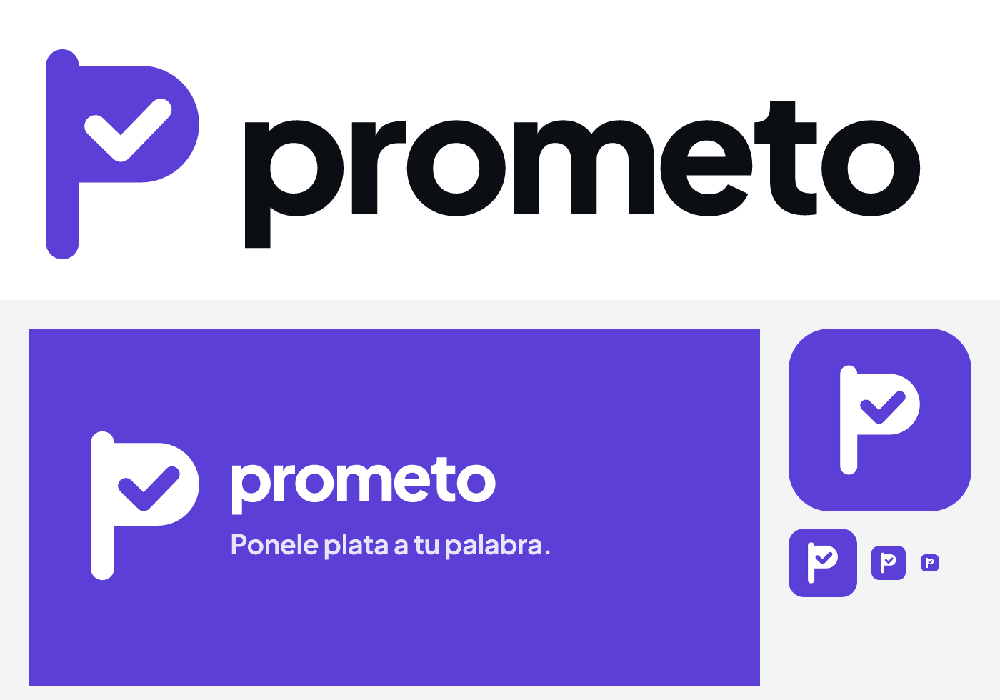

# Prometo: guía de marca

## La idea
**Prometo** = "yo prometo". Una palabra que todos dicen y casi nadie cumple. La marca convierte esa palabra en algo que vale plata.

- **Tagline:** *Ponele plata a tu palabra.* (EN: *Put money behind your word.*)
- **En una línea:** promesas y desafíos con amigos, con plata de verdad. El que cumple, cobra.

## El logo
Una **"P" que también es una bandera plantada con un check**: la promesa (P) cumplida (✓), la meta alcanzada (la bandera). Es un solo símbolo que se lee a 16 px, no se parece a ninguna app de finanzas y funciona en blanco sobre violeta o en violeta sobre blanco.

| Pieza | Archivo | Uso |
|---|---|---|
| Ícono de app | `app-icon.svg`, `icon-1024.png`, `icon-512.png` | Stores, PWA, logo de la entrega |
| Ícono adaptable (Android) | `app-icon-maskable.svg`, `icon-maskable-512.png` | Play Store / launcher (zona segura del 72 %) |
| Símbolo violeta | `glyph-violet.svg` | Splash, bienvenida, encabezado |
| Símbolo blanco | `glyph-white.svg` | Sobre fondo violeta |
| Logotipo | `lockup.svg`, `lockup.png` | Presentaciones, web |
| Imagen al compartir | `og.svg`, `og.png` (1200×630) | Vista previa en WhatsApp, X, Telegram |
| Banner Play Store | `feature.svg`, `feature.png` (1024×500) | Ficha de Google Play |

**Reglas:** no deformar ni rotar; no poner sombras ni degradés; aire alrededor igual al ancho del palo de la P; tamaño mínimo 16 px.

## Color
Un solo color de marca. Todo lo demás es blanco, negro y grises (ver la skill `native-clean`).

| Token | Hex | Para qué |
|---|---|---|
| Violeta Prometo `--accent-500` | `#5B3FD6` | Logo, botón principal, links |
| Violeta profundo `--accent-600` | `#4A31B8` | Hover, iniciales |
| Violeta claro `--accent-50` | `#EFEBFC` | Fondo de avatares |
| Tinta `--ink-950` | `#0B0E12` | Títulos, montos, íconos |
| Gris `--ink-500` | `#68717B` | Texto secundario |
| Verde `--success` | `#14804A` | Solo "cumpliste" / variaciones buenas |
| Rojo `--danger` | `#D92D20` | Solo pérdidas reales |

Por qué violeta: es el color de lo social y lo competitivo (gaming, comunidades), no choca con el verde ni el rojo, que en esta app tienen significado (cumplir o perder), y se diferencia del azul y el verde de las apps de plata.

## Tipografía
**Plus Jakarta Sans.** Logotipo en minúscula, ExtraBold 800, interletra −4 %. Títulos 700, texto 500 y 600. Los números usan cifras tabulares.

## Voz
Habla como un amigo que te banca, no como un banco.
- **Corto y en segunda persona:** "Cumplí hoy", "Ya cumpliste hoy · volvé mañana".
- **Blockchain invisible:** decimos "dólares digitales", "cuenta" y "comprobante"; nunca "wallet", "gas" ni "token".
- **Nunca "apuesta":** decimos "pozo", "desafío", "el que cumple, cobra".
- **Honestos con la plata:** antes de cada acción se muestra cuánto pone cada uno y cuánto cobra el que gana.

## Momento de marca
El **splash**: la bandera "se planta" (sube y rebota) y aparece "prometo". Dura menos de un segundo y es lo primero que se ve al abrir la app.
